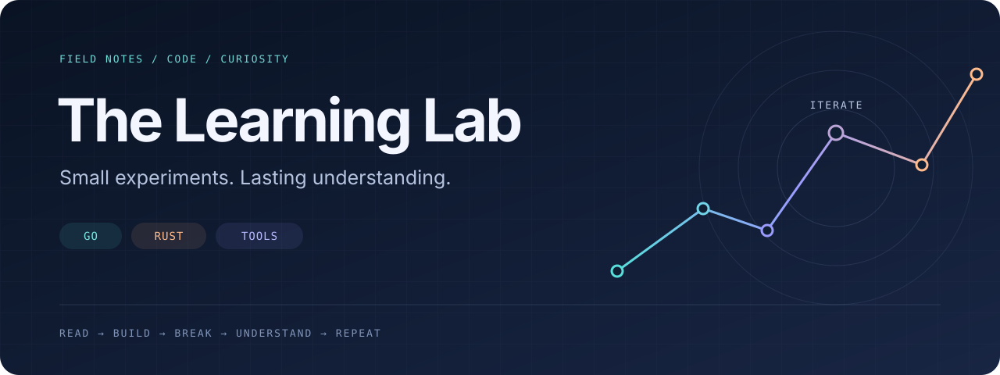

<p align="center">
  
</p>

<p align="center">
  <strong>A personal workshop for learning by writing code.</strong><br>
  Chapter by chapter, from a first hello to generics, error handling, and containers.
</p>

<p align="center">
  <a href="#explore-the-lab">Explore</a> &nbsp;·&nbsp;
  <a href="#start-building">Start building</a> &nbsp;·&nbsp;
  <a href="#the-go-field-guide">Go field guide</a> &nbsp;·&nbsp;
  <a href="#inside-the-workshop">Repository map</a>
</p>

---

## Explore the lab

This is my personal learning repository, always changing as I explore new ideas, practice new skills, and revisit what I’ve learned. It currently collects small, focused exercises in **Go**, early explorations in **Rust**, and practical experiments with **Docker and Python**. Each folder captures a concept in code: something to run, inspect, change, and understand.

Expect new topics, revised exercises, and an evolving structure as my learning journey continues.

| Track | What's inside | Start here |
| :--- | :--- | :--- |
| **01 · Go** | Eleven chapters covering fundamentals, functions, pointers, interfaces, generics, errors, packages, and embedded files. | [Browse the exercises →](learning-go/) |
| **02 · Rust** | Hello world, a first Cargo project, and an interactive number guessing game. | [Explore Rust →](learning-rust/) |
| **03 · Tools** | A Go HTTP server, a Python book analyzer, and Dockerfiles for both. | [Open the toolbox →](tools/docker/) |

> **The approach:** keep experiments small enough to understand, then change one thing and observe what happens.

## Start building

Run the examples below from the repository root. Each command uses a subshell so your working directory stays there.

**Bring the tools for the track you choose:** the Go modules declare `go 1.26.4`; the Rust projects use edition `2024` and need a compatible Rust toolchain with Cargo. The book analyzer uses Python 3, and the container examples need Docker.

### 01 / Say hello in Go

```sh
(cd learning-go/ch01 && go run .)
```

Continue with a small exercise in closures:

```sh
(cd learning-go/ch05 && go run ./exercise03)
```

```text
Hello Bob
Hello Maria
```

### 02 / Play with Rust

```sh
(cd learning-rust/ch2/guessing_game && cargo run)
```

Guess a secret number between **1 and 100**. The program responds with `Too small!` or `Too big!` until you find it. Invalid numeric input is ignored so you can try again.

For a smaller first step:

```sh
(cd learning-rust/ch1/hello_cargo && cargo run)
```

### 03 / Turn a book into data

```sh
(cd tools/docker && python3 main.py)
```

The analyzer reads the included *Frankenstein* text and prints a word count followed by alphabetic character frequencies, sorted from most to least common.

## The Go field guide

Follow the chapters in order, or jump directly to a concept.

| Chapter | Focus | What you'll find |
| :--- | :--- | :--- |
| [01](learning-go/ch01/) | **First steps** | Hello world and a Makefile. |
| [02](learning-go/ch02/) | **Values & types** | Numeric conversions, constants, and integer overflow. |
| [03](learning-go/ch03/) | **Collections & text** | Shared slice storage, Unicode runes, and structs. |
| [04](learning-go/ch04/) | **Control flow** | Loop forms, conditionals, and variable shadowing. |
| [05](learning-go/ch05/) | **Functions** | A calculator using function values, file reading, and closures. |
| [06](learning-go/ch06/) | **Pointers & memory** | Value and pointer constructors, slice mutation, and allocation. |
| [07](learning-go/ch07/) | **Methods & interfaces** | League standings, ranking methods, and output through `io.Writer`. |
| [08](learning-go/ch08/) | **Generics** | Numeric constraints, type sets, and `fmt.Stringer`. |
| [09](learning-go/ch09/) | **Errors** | Employee validation with sentinel errors, custom types, and `errors.Join`. |
| [10](learning-go/ch10/numsum/) | **Packages & tests** | A generic `numsum.Add` library with table-driven and numeric-type tests. |
| [11](learning-go/ch11/) | **Embedded assets** | A command-line program with embedded text in four languages. |

<details>
<summary><strong>Try a few more Go experiments</strong></summary>

Print league standings through an interface:

```sh
(cd learning-go/ch07 && go run ./exercise03)
```

Explore validation that reports multiple errors:

```sh
(cd learning-go/ch09 && go run ./exercise03)
```

Run the numeric library's tests:

```sh
(cd learning-go/ch10/numsum && go test ./...)
```

Read an embedded text:

```sh
(cd learning-go/ch11 && go run . italian)
```

Supported language arguments: `english`, `italian`, `french`, and `spanish`.

</details>

## Container corner

The Docker experiments live in [`tools/docker`](tools/docker/). Try the Go server locally:

```sh
(cd tools/docker && PORT=8991 go run .)
```

Open **http://localhost:8991**. Stop the server with `Ctrl+C`.

To run the Python analyzer in a disposable container:

```sh
(cd tools/docker && docker build -f Dockerfile.py -t learning-book-report .)
docker run --rm learning-book-report
```

The Go [`Dockerfile`](tools/docker/Dockerfile) copies a prebuilt `bootdevdocker` executable. Rebuild it for Linux and your Docker engine's architecture before building the image; for example, for an AMD64 engine:

```sh
(cd tools/docker && CGO_ENABLED=0 GOOS=linux GOARCH=amd64 go build -o bootdevdocker .)
(cd tools/docker && docker build --platform linux/amd64 -t learning-go-server .)
docker run --rm -p 8991:8991 learning-go-server
```

For an ARM64 engine, use `GOARCH=arm64` and `--platform linux/arm64` instead. The build command replaces the existing executable in that folder.

## Inside the workshop

```text
learning-repo/
├── learning-go/
│   ├── ch01/                  Hello world
│   ├── ch02/ … ch09/          Focused chapter exercises
│   ├── ch10/numsum/           Generic library + tests
│   └── ch11/                  Embedded multilingual text
├── learning-rust/
│   ├── ch1/
│   │   ├── hello_world/       Standalone Rust source
│   │   └── hello_cargo/       First Cargo project
│   └── ch2/guessing_game/     Interactive CLI game
└── tools/docker/
    ├── main.go                HTTP server
    ├── main.py                Book analyzer
    ├── Dockerfile             Go container
    ├── Dockerfile.py          Python container
    └── books/                 Input text
```

**Independent projects, shared curiosity.** Go chapters have their own modules, with chapter 10's module nested under `numsum`. Rust Cargo projects have separate manifests. Run commands inside the relevant project; there is no single root-level build or test command.

## Make an experiment your own

1. **Read** an exercise and predict its output.
2. **Run** it and compare the result with your prediction.
3. **Change** an input, a type, or a branch.
4. **Explain** why the behavior changed.
5. **Test** the behavior when there's a useful expectation to capture.

These are learning exercises at different stages of development. The interesting part is seeing how each idea becomes executable.

---

<p align="center">
  <strong>Understanding is built one experiment at a time.</strong><br>
  <sub>Stay curious. Keep building.</sub>
</p>
